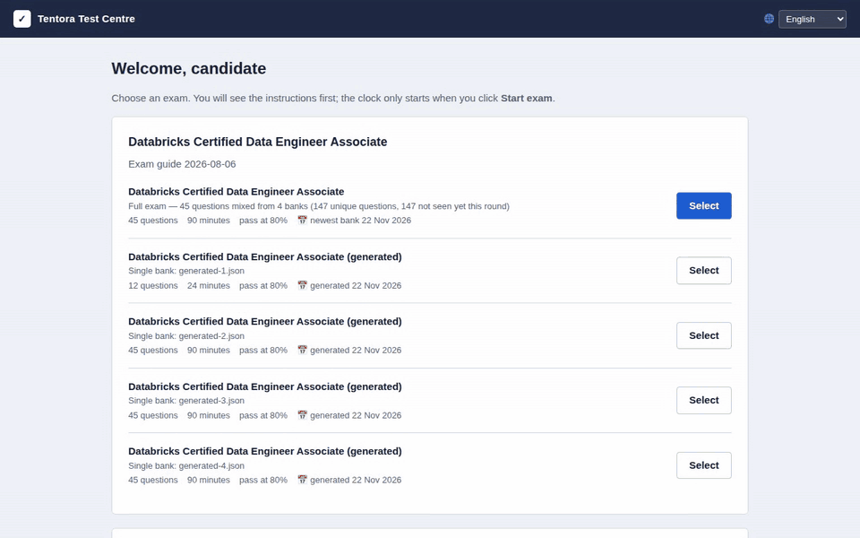
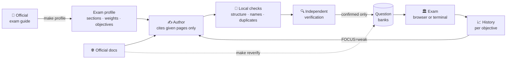

<p align="center">
  
</p>

<h1 align="center">Tentora</h1>

<p align="center">
  <strong>Rehearse your certification exam before it counts.</strong><br>
  Realistic, timed practice exams with questions grounded in the official docs, checked twice, and every answer sourced.
</p>

<p align="center">
  <a href="https://github.com/demasj/tentora/actions/workflows/test.yml"></a>
  <a href="LICENSE"></a>
  
  
  <a href="CONTRIBUTING.md"></a>
</p>

<p align="center">
  
</p>

---

**Tentora** comes from the Latin *tentāre*, "to try, to put to the test". The
Dutch word *tentamen* (exam) comes from the same root. That is the whole idea:
a place to try the exam as often as you like, so the real one feels familiar.

## Why Tentora

🏛️ **It feels like the real test centre.** The clock runs on the server and
keeps going if you close the tab. You can mark questions for review, strike out
answers, use an overview screen and change the font size. Unscored items are
mixed in and not identified, just like the real exam. You see no answers until
you submit.

📚 **Every question is grounded in the official docs.** Questions are written
only from official documentation pages, then a *separate* check confirms the
answer against those same pages. Anything that isn't confirmed is discarded.
Each question cites its sources and maps to an objective from the official exam
guide.

🔄 **It stays current.** Products get renamed and docs change. `make reverify`
re-checks every question against today's docs and retires the ones that are now
wrong. Outdated product names are rejected before a question is ever saved.

🎯 **It scores like the real exam, and learns your weak spots.** Pass/fail uses
the official section weights, not a plain count. Every attempt is logged per
objective, and `FOCUS=weak` generates new questions for the sections you miss
most.

🧩 **It works for any certification with an official exam guide.** One command
turns the guide PDF into an exam profile: question count, time limit, sections,
weights and objectives. Generation, scoring and the exam UI all follow from
that profile.

🔒 **It's local and private.** Pure Python standard library, nothing to install,
no account and no tracking. Your attempts stay on your machine.

## How it works



## Quick start

```bash
git clone https://github.com/demasj/tentora.git && cd tentora
make web     # open http://localhost:8080 and start an exam (uses Docker)
make take    # ...or sit it right in your terminal
```

Want fresh questions? `make generate` writes and verifies a new set. It needs
the [`claude` CLI](https://claude.com/claude-code). See
[Getting started](docs/getting-started.md) for everything else.

## Available exams

| Exam | Questions | Exam guide |
|------|----------:|------------|
| Databricks Certified Data Engineer Associate | 147 unique, in 4 banks | 6 August 2026 |

Missing your exam? [Add it](docs/question-generation.md#adding-another-exam).
It takes one command and a review, and a pull request is very welcome.

## Documentation

| | |
|---|---|
| 🚀 [Getting started](docs/getting-started.md) | Requirements, browser and terminal exams, project layout |
| ✍️ [Question generation](docs/question-generation.md) | Adding an exam, how questions are written and verified, `reverify` |
| 📊 [Scoring](docs/scoring.md) | Topic-weighted pass/fail, unscored items, reported questions |
| 🗂️ [Bank format](docs/format.md) | The open JSON format for question banks |

## Disclaimer

Tentora is an independent community project. It is not affiliated with,
endorsed by or sponsored by Databricks or any other exam provider; product
names are trademarks of their owners. The bundled questions are AI-written
practice material, checked against the public documentation. They are **not**
real exam questions, they can contain mistakes, and passing them does not mean
you will pass the real exam. Spot a wrong question? Report it in the review
screen or [open an issue](https://github.com/demasj/tentora/issues/new/choose).

Official exam guides are not included, because they belong to the exam
provider. Download the guide from the provider's certification page and run
`make profile`.

## Contributing

New exams, question fixes and code are all welcome. Read
[CONTRIBUTING.md](CONTRIBUTING.md) and run `make test` before you open a pull
request.

## License

[MIT](LICENSE). Exam guides and their contents remain the copyright of their
publishers.
